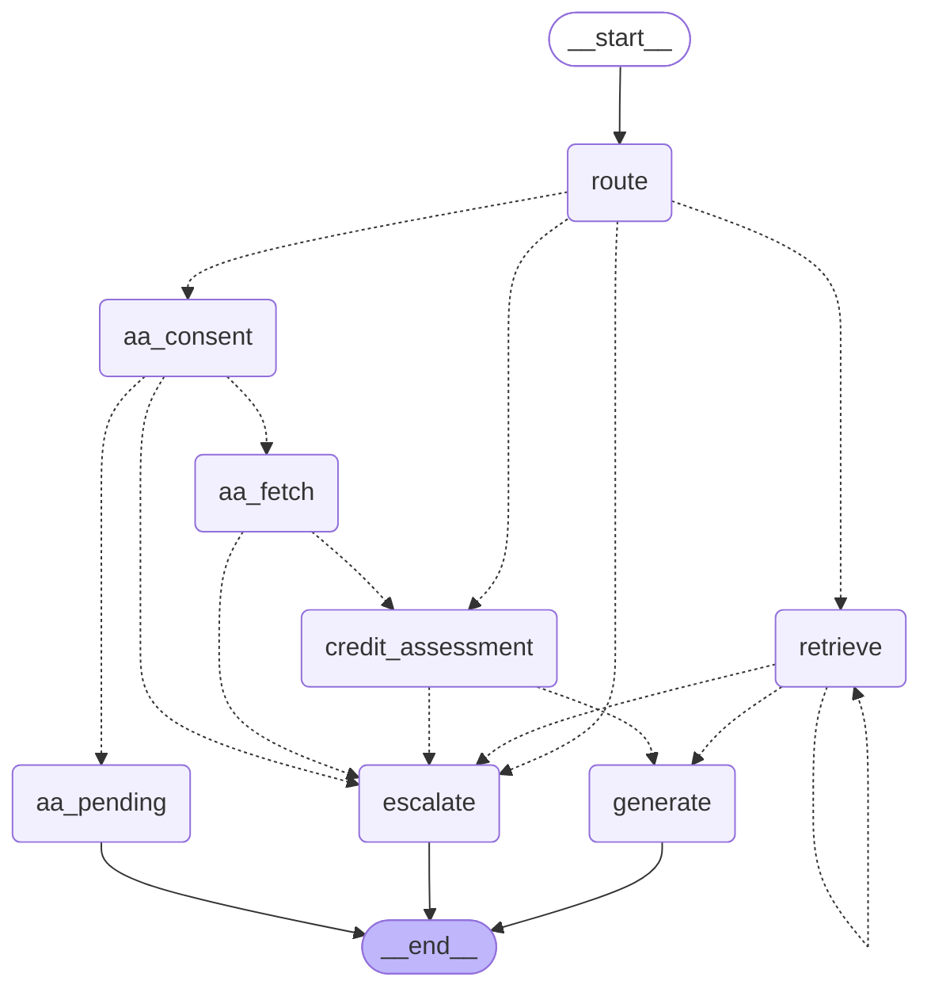

# LangGraph state machine

This diagram is generated directly from the compiled graph
(`agent.graph.build_graph().get_graph().draw_mermaid()`), not hand-drawn — it
is guaranteed to match `agent/graph.py`'s actual nodes and edges. Regenerate
it with:

```bash
python -c "from agent.graph import build_graph; print(build_graph().get_graph().draw_mermaid())"
```



Dotted edges are conditional (`add_conditional_edges`); solid edges are
unconditional (`add_edge`).

- **`route`** → `credit_assessment` (credit query) | `retrieve` (policy
  query) | `escalate` (off-topic — no LLM call, per `_route_decision`)
- **`retrieve`** → itself (context still insufficient, loops up to
  `MAX_LOOP_ITERATIONS`) | `generate` (sufficient) | `escalate` (loop cap
  hit without sufficiency — never generates ungrounded, per
  `_should_continue_retrieval`)
- **`route`** also → `aa_consent` when the request carries an `aa_handle` and the route is credit (live Account Aggregator data)
- **`aa_consent`** → `aa_fetch` (consent ACTIVE) | `aa_pending` (waiting for the person to approve) | `escalate` (declined, revoked,
  expired, gateway error, or no Setu credentials configured, as on the public demo)
- **`aa_fetch`** → `credit_assessment` (data fetched and normalised to the 8 signals) | `escalate` (fetch failed)
- **`aa_pending`** → `__end__`: returns the consent URL and asks the person to approve, then ask again. No LLM, no score.
- **`credit_assessment`** → `generate` (tool succeeded) | `escalate` (tool
  returned an error — never narrated as a real assessment, per
  `_should_generate_from_credit_assessment`)
- **`generate`** / **`escalate`** → `__end__`

`escalate` never calls an LLM — it returns a fixed, per-language message
directly (`_DEFAULT_ESCALATION_MESSAGE` / `_TOOL_ERROR_ESCALATION_MESSAGE`),
which is why an off-topic query or a failed tool call is both cheaper and
faster than a normal answer, not slower.

## Failure paths inside `generate` (no extra graph edges)

The graph's shape did not change, but `generate` is no longer a single happy path. It fails
closed to a fixed, human-escalating answer (`failure_reason` in the response and trace) instead
of raising:

| Condition | `failure_reason` | Answer |
|---|---|---|
| Provider outage / timeout / 429 (one retry first) | `llm_unavailable` | fixed "language model is not responding" message (en / hi / kn) |
| Model keeps returning invalid JSON after the retry | `invalid_structured_output` | same fixed message |
| English policy answer states a figure not in the retrieved text, or < 50% of its content words appear there (`guardrails/grounding.py`) | `ungrounded_answer` | fixed "could not verify" message, no sources |
| Anything else raises inside the graph (API layer) | `internal_error` | the standard escalation message |

Before the graph runs, the API layer redacts PAN / Aadhaar / mobile numbers; `route` and
`retrieve` see the question without its PII sentence (`retrieval_query`), `generate` sees the
redacted text. Escalations and fixed fallbacks never cite sources they were not generated from.

## Live Account Aggregator path (`agent/nodes/aa.py`)

A real consent is approved by a human on their own phone, minutes after the request that created it, so the graph pauses at
`aa_pending` and resumes on the next request with the same `session_id` (or after the optional `POST /webhooks/setu/consent`).
Consent state lives in a small SQLite store (`memory/consent_store.py`: consent id, URL, status, and a hash of the mobile; never bank
data), so a restarted Space does not forget a pending consent. That store, not an in-memory checkpointer, is what makes the graph
resumable. Three rules:

1. **The raw bank payload never leaves `aa_fetch`.** It is normalised to the same 8 numeric signals the scoring API takes and
   dropped: not in graph state, not in traces, not in an LLM prompt. Only the 8 numbers continue through the existing credit path.
2. **A webhook is a hint, not an authority.** It must carry `SETU_WEBHOOK_SECRET`, and the handler re-reads the real status from
   Setu before updating anything, so a forged body cannot approve a consent.
3. **Every failure is a fixed hand-off.** Nothing here can produce a score from data we did not get.
